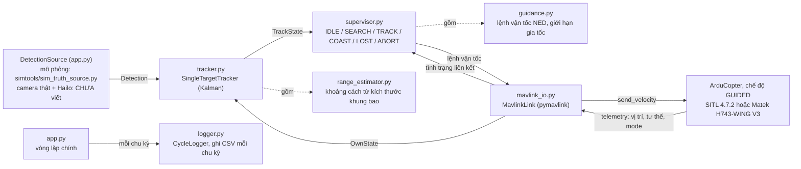

# DHTT-Drone-Tracking

Quad 8 inch tự bay: tự bám một mục tiêu (drone khác) bằng camera, giữ khoảng cách an toàn, điều khiển bằng ArduCopter. Giai đoạn hiện tại là mô phỏng và demo trên bàn. Chưa có lần bay thật nào.


> **Trạng thái (cập nhật 2026-11-17)**
> - Mô phỏng bám, bay thẳng 10 m/s, giữ 25 m (`onboard/`): **ĐANG LÀM.** Khớp gật đạt một lần (một seed). Chưa chạy đủ 3 seed × 2 lần. Mã bám chưa được rà soát độc lập.
> - Nhận diện trên video (`vision/`): **ĐANG LÀM.** Mục tiêu trên 40 px đạt khoảng 92%. Mục tiêu 10–40 px chưa có số đáng tin. Trên 114 video drone: 92,6% khung có phát hiện, nhưng chỉ 38% video giữ được một ID, và máy bay bị nhận thành drone.
> - Demo lab trên PC (`lab/`): **ĐẠT** với video ghi sẵn. Trên Raspberry Pi 5 và camera thật: **CHƯA CHẠY THẬT**.
> - Gazebo (`gazebo/`): **ĐẠT** với một máy bay. Hai máy bay: **CHƯA LÀM**. Bay thật: **CHƯA CHẠY THẬT**.
>
> Chú thích: ĐẠT · CHƯA ĐẠT · CHƯA CHẠY THẬT · ĐANG LÀM.

## Dự án là gì

- Drone quad 8 inch tự bay theo hành trình, hoặc bám một mục tiêu bay (drone khác) và giữ khoảng cách an toàn. Dự án không có chức năng áp sát hay va chạm. Khoảng cách giữ là điều kiện an toàn bắt buộc.
- Mẫu tham khảo là quad Blackbird trong video [The Fastest Drone Ever Flown](https://www.youtube.com/watch?v=k9n1h0rn9No).
- **Mô phỏng trước, phần cứng sau.** Mọi thuật toán chạy qua ArduPilot SITL hoặc Gazebo trước khi lên drone.
- **Firmware ArduPilot (ArduCopter)**, không dùng PX4.
- **Radio** Radiomaster Pocket và RX XR4: trong lab chỉ đọc kênh RC. Khi bay thật, dự kiến dùng tay điều khiển và kính FPV để cất cánh và đưa drone vào hành trình, sau đó camera AI tự nhận diện và bám; trạm GCS (Mission Planner) để theo dõi. Phần này chưa có kế hoạch riêng.

## Hướng đi và lộ trình

Quyết định ngày 2026-11-17 là hướng "dung hòa": phần tự bay bám **chỉ ở mức mô phỏng**. Phần cứng và bay thật đi theo **sáu bước có cổng duyệt B1–B6**. Mỗi bước được chủ dự án duyệt trước khi sang bước sau.

| Bước | Nội dung | Trạng thái | Ghi chú |
|---|---|---|---|
| B1 | Nhận diện và theo dõi ID trên video ghi sẵn | ĐANG LÀM | Xem mục Nhận diện |
| B2 | Máy tính AI và camera trên bàn | CHƯA CHẠY THẬT | Pi 5 đã có. AI HAT+ chưa có |
| B3 | Nối bộ điều khiển bay qua MAVLink, chỉ đọc | CHƯA CHẠY THẬT | Mọi thao tác ghi lên FC cần duyệt riêng |
| B4 | Mô phỏng và an toàn | ĐANG LÀM | Xem mục Mô phỏng |
| B5 | Thử tích hợp trên mặt đất | CHƯA CHẠY THẬT | Chốt camera và khoảng cách giữ |
| B6 | Bay quan sát có kiểm soát | CHƯA CHẠY THẬT | Chỉ sau khi B1–B5 đạt và được duyệt |

## Mục tiêu thiết kế

Đây là mục tiêu thiết kế. Chưa có phần cứng nào đạt các con số này.

| Hạng mục | Mục tiêu | Trạng thái | Ghi chú |
|---|---|---|---|
| Tốc độ tối đa | 400 km/h | CHƯA ĐẠT (chưa có bằng chứng) | Thay cho 350 km/h. Chốt ngày 2026-11-17 |
| Tốc độ hành trình | 200–250 km/h | CHƯA ĐẠT (chưa có bằng chứng) | Chưa xem lại sau khi đổi tốc độ tối đa |
| Tốc độ mục tiêu bám được | khoảng 270–290 km/h | CHƯA CHẠY THẬT | Ước tính, chưa kiểm bằng mô phỏng |
| Khoảng cách giữ | 25 m trong nghiệm thu mô phỏng | ĐANG LÀM | Chọn từ đo 15, 25, 40 m. Chốt chính thức ở B5 |
| Góc nghiêng | 65–75° khi bay 350–400 km/h | CHƯA CHẠY THẬT | ArduCopter giới hạn 80°. Chưa tính lại cho 400 km/h |
| Điều khiển | Lệnh vận tốc NED, GUIDED, 10–20 Hz | ĐANG LÀM (SITL). CHƯA CHẠY THẬT trên FC | Qua pymavlink |
| Camera mô phỏng | Khớp gật một trục điều khiển bằng servo | ĐANG LÀM | Hướng thiết kế đã chốt. Chưa lắp |

## Phần cứng

| Hạng mục | Lựa chọn | Trạng thái |
|---|---|---|
| Flight controller | Matek H743-WING V3 (vào 9–36 V, cảm biến dòng khoảng 132 A) | ĐÃ CÓ |
| Máy tính đồng hành | Raspberry Pi 5 8 GB kèm tản nhiệt | ĐÃ CÓ |
| Tăng tốc AI | AI HAT+ (Hailo-8, 26 TOPS) | CHƯA CÓ. Lab chạy nhận diện bằng CPU của Pi |
| Camera bay | Raspberry Pi Global Shutter (IMX296, 1456×1088, ngàm CS), lens 6 mm hoặc 8 mm | CHƯA CÓ. Khan hàng ở các nguồn đã tra |
| Camera lab | Raspberry Pi Camera Module 3 Wide | Đã chọn cho lab, đang đặt mua. Khác camera dự kiến bay |
| Khung | Apex HD 8 inch 362 mm làm đế, vỏ in 3D kiểu tên lửa | DỰ KIẾN. Số liệu khung chưa xác minh |
| Động lực | Motor 3110 **không đủ** (khoảng 0.9 kW mỗi cái). Ứng viên 3115, 3120, 3220 kèm ESC 200 A | CHƯA CHỐT. Chốt sau chặng 3 |
| Radio (lab) | Radiomaster Pocket + RX XR4 | ĐÃ CÓ |
| Sạc pin | ToolkitRC M8D | ĐÃ CÓ |
| Trạm GCS | Mission Planner trên laptop Windows 11, 10–13 inch cảm ứng | CHƯA CHỌN MÁY |

Nguồn trạng thái phần cứng: chủ dự án và `.office/ledger.md` (2026-11-17).

## Kiến trúc phần mềm bám

Mã nằm trong `onboard/dtrack/`. Hiện `capture` và `detect` gộp thành giao diện `DetectionSource` trong `app.py`, chưa có file riêng.



| Module | File | Vai trò |
|---|---|---|
| Hợp đồng dữ liệu | `onboard/dtrack/types.py` | `Detection`, `TrackState`, `OwnState`, `GuidanceCommand`; thế giới NED, thân FRD |
| Hình học | `onboard/dtrack/geometry.py` | Quaternion, chiếu tia camera sang NED |
| Bám | `onboard/dtrack/tracker.py` | Bộ lọc Kalman bám một mục tiêu |
| Khoảng cách | `onboard/dtrack/range_estimator.py` | Ước lượng từ kích thước khung bao (camera đơn không đo sâu trực tiếp) |
| Điều khiển | `onboard/dtrack/guidance.py` | Lệnh vận tốc, giới hạn gia tốc |
| Giám sát | `onboard/dtrack/supervisor.py` | Máy trạng thái, dừng, ABORT |
| MAVLink | `onboard/dtrack/mavlink_io.py` | Đọc telemetry, gửi lệnh vận tốc, RTL |
| Nhật ký | `onboard/dtrack/logger.py` | Ghi CSV mỗi chu kỳ |
| Vòng lặp | `onboard/dtrack/app.py` | Ghép các module; `config.py` nạp cấu hình và hồ sơ nghiệm thu |

## Trạng thái từng phần

| Phần | Trạng thái | Số đo | Nguồn |
|---|---|---|---|
| `onboard/` pytest | ĐẠT (kiểm đơn vị) | 205 passed | sổ ghi 2026-11-17 (chạy lại) |
| `onboard/` khớp gật, giữ 25 m, 10 m/s | ĐANG LÀM | một lần đạt: TB 0,57 m, min 9,29 m, bám 100% | sổ ghi 2026-11-17 |
| `onboard/` nghiệm thu 3 seed × 2 lần | CHƯA CHẠY THẬT | chưa có lần nào hoàn tất | sổ ghi 2026-11-17 |
| `onboard/` camera cố định, lens rộng | CHƯA ĐẠT | xem bảng Mô phỏng | sổ ghi 2026-11-17 |
| `sim/` chặng 1 (cũ, ngừng sửa) | CHƯA ĐẠT ở phanh cuối | trong cửa sổ 120 s: ĐẠT. Sau cửa sổ, khoảng cách thật tụt còn 0,14–6,61 m | sổ ghi 2026-11-16 |
| `vision/` nhận diện | ĐANG LÀM | xem mục Nhận diện | `vision/results/SUMMARY.md` |
| `lab/` trên PC | ĐẠT (video ghi sẵn) | 45 passed; 21,5 khung/giây, trễ 64 ms (số tự báo cáo, chưa đo lại) | sổ ghi 2026-11-17 |
| `lab/` trên Pi 5, camera thật | CHƯA CHẠY THẬT | — | — |
| `gazebo/` một máy bay | ĐẠT | chạy được, camera 640×480 ~10 khung/giây | `gazebo/README.md`, sổ ghi 2026-11-17 |
| `gazebo/` hai máy bay | CHƯA LÀM | — | — |
| `cad/` khớp gật | ĐẠT (thiết kế) | không va chạm ở −60° đến +60° | sổ ghi 2026-11-17 |
| `cad/` in và lắp | ĐANG LÀM | người dùng đang in; kích thước chưa đo vật thật | sổ ghi 2026-11-17 |
| `gcs/` logic | ĐẠT (kiểm logic) | PASS=171, FAIL=0 | chạy lại 2026-11-17 |
| `gcs/` cài thật | CHƯA CHẠY THẬT | chưa có laptop đích; chữ ký gói chưa kiểm | `gcs/README.md` |
| Phần cứng bay | CHƯA CHẠY THẬT | chưa bay lần nào | — |

## Mô phỏng

### Nghiệm thu hiện tại

Kịch bản: mục tiêu **bay thẳng** ở 10 m/s, tăng tốc lúc đầu, phanh khoảng 8 m/s² lúc cuối. Drone bám bằng khớp gật, giữ 25 m.

Tiêu chí: sai số trung bình dưới 3 m trong cửa sổ đo; khoảng cách thật không dưới 8 m suốt chuyến (kể cả lúc mục tiêu phanh); bám ít nhất 90%. Chạy 3 seed, mỗi seed 2 lần. Thêm mất hình 3 s (min không dưới 8 m, bắt lại được) và giành quyền (ngừng lệnh dưới 0,1 s). Tiêu chí cũ (đổi hướng, 15 m) đã thay ngày 2026-11-17.

Trạng thái: **ĐANG LÀM.**

| Cấu hình (10 m/s, seed 1, 1 lần mỗi ô) | Giữ 15 m | Giữ 25 m | Giữ 40 m |
|---|---|---|---|
| Camera cố định, lens 6 mm | CHƯA ĐẠT: TB 0,32 m, min 5,40 m | CHƯA ĐẠT: TB 0,43 m, min 7,40 m | CHƯA ĐẠT: TB 3,46 m |
| Khớp gật (servo) | CHƯA ĐẠT: TB 0,32 m, min 5,81 m | **ĐẠT** (một lần): TB 0,57 m, min 9,29 m, bám 100% | CHƯA ĐẠT: TB 3,90 m |
| Lens 4 mm | — | CHƯA ĐẠT: TB 0,72 m, min 7,07 m | — |

| Kiểm khác | Kết quả | Trạng thái |
|---|---|---|
| Mất hình 3 s (khớp gật, 25 m, 10 m/s) | min 11,12 m, bám 97,5% | ĐẠT (một lần) |
| Ca có rẽ (khớp gật, 25 m) | min 8,14 m | Số tham khảo, không thuộc tiêu chí |
| Giành quyền: ngừng gửi lệnh | 0,021 s | ĐẠT (cấu hình trước khi chốt khớp gật) |
| Khớp gật, 20 m/s | TB 0,42–1,14 m nhưng min 1,64–3,74 m ở pha phanh | CHƯA ĐẠT. Ngoài phạm vi nghiệm thu hiện tại |
| 3 seed × 2 lần ở 25 m; rà soát độc lập mã bám | chưa chạy, chưa có | CHƯA CHẠY THẬT |

Nguyên nhân các lần thất bại (điều tra 2026-11-17, chưa có phép thử vòng kín xác nhận đủ): khi mất mục tiêu, drone đứng yên thay vì bay tiếp theo vận tốc ước lượng. Giới hạn phanh 0,8 m/s² quá thấp. Vòng giữ mục tiêu giữa ảnh bằng độ cao đẩy mục tiêu ra mép khung. Gia tốc ngang không đủ khi rẽ ở 20 m/s. Một phần đã sửa trong mã. Lệnh chạy hàng loạt `onboard/simtools/run_acceptance.sh` chưa hoàn tất lần nào.

### Bảng khả thi tốc độ (chỉ tính, không mô phỏng)

Nguồn: `onboard/docs/feasibility_speed.md`, tạo bởi `onboard/simtools/feasibility_table.py`. Công thức: khoảng cách an toàn = v·τ + v²/(2a_chaser) − v²/(2a_mục tiêu) + sai số + 8 m. Giả định τ = 0,35 s và a_chaser = 4,1 m/s² lấy từ SITL quad 0,8 kg, **không phải máy thật**. Số đo chỉ đến 10 m/s, phần còn lại là ngoại suy.

| Tốc độ | Mục tiêu phanh 8 m/s², lens 6 mm | Ghi chú |
|---|---|---|
| 10 m/s (36 km/h) | khoảng cách an toàn 17,9 m | Mục tiêu còn khoảng 29 px |
| 20 m/s (72 km/h) | 41,3 m | Mục tiêu còn khoảng 13 px, dưới ngưỡng 20 px |
| 30 m/s (108 km/h) | 82,0 m | Dưới ngưỡng 20 px |
| 400 km/h (111 m/s) | không có nghiệm | Cách "bay sau, giữ khoảng cách" không còn dùng được |

Tốc độ cao nhất mà mục tiêu còn ít nhất 20 px là khoảng 14 m/s (51 km/h) khi mục tiêu phanh 8 m/s². Tốc độ cao cần phương án khác, chưa chọn.

## Nhận diện (`vision/`)

Model `ft_v8n`: YOLOv8n tinh chỉnh trên tập DUT Anti-UAV, 20 epoch, chạy CPU. Chưa đo trên Raspberry Pi 5 hay Hailo.

| Số đo | Giá trị | Trạng thái | Nguồn |
|---|---|---|---|
| Ảnh test có ảnh train gần trùng cảnh | 67,6% (1486/2200) | Rò rỉ dữ liệu, số toàn tập test lạc quan | `vision/results/verify/` (kiểm 2026-11-17) |
| Tập sạch (684 ảnh, chủ yếu mục tiêu trên 40 px), ngưỡng 0,25 | recall 0,92; 29,8 báo động giả / 100 ảnh | Đáng tin ở mức tập sạch | `vision/results/verify/analysis_out.txt` |
| Tập sạch, ngưỡng 0,5 | recall 0,87; 8,6 báo động giả / 100 ảnh | Đáng tin ở mức tập sạch | như trên |
| Mục tiêu 10–40 px | chưa có số đáng tin (28 mẫu cho 20–40 px, 1 mẫu cho 10–20 px) | CHƯA CHẠY THẬT | như trên |
| Tiêu chí: recall ≥ 0,90 ở 20–40 px, tối đa 20 báo động giả / 100 ảnh | 0,93 nhưng 29,8 báo động giả ở 0,25; 0,89 ở 0,5 | CHƯA ĐẠT | `vision/results/verify/analysis_out.txt`, sổ ghi 2026-11-17 |
| Video máy bay (4 video) | model gắn nhãn "drone" ở mọi khung được chấm | CHƯA ĐẠT. Cần ảnh âm khi huấn luyện lại | sổ ghi 2026-11-17 |
| Hai model `best.pt` cũ | recall 0,38–0,46 trên tập test | CHƯA ĐẠT. Không dùng | sổ ghi 2026-11-17 |

### Theo dõi ID trên video (B1)

Chạy trên 119 video ghi sẵn (114 video drone, 4 video máy bay; 640×512, khoảng 10 s mỗi video; không có nhãn). Ngưỡng 0,25, ByteTrack. Số của người làm, đang được đo lại độc lập. Bảng đầy đủ: `vision/results/b1/B1_TABLES.md`.

| Số đo (114 video drone) | Cắt vùng 320 quanh mục tiêu | Đưa cả khung hình |
|---|---|---|
| Khung có phát hiện | 92,6% | 91,2% |
| Khung có đúng một mục tiêu được theo dõi | 89,7% | 82,9% |
| Video giữ được một ID suốt đoạn | 38% | 30% |
| Số ID trung bình mỗi video (lý tưởng là 1) | 3,2 | 5,3 |

- **CHƯA ĐẠT, giữ ID:** phần lớn video bị tách thành nhiều ID; khi ID đổi thì khóa mục tiêu bị rớt.
- **CHƯA ĐẠT, nhầm lớp:** trên 4 video máy bay (1274 khung), model gắn nhãn "drone" ở 1274/1274 khung. Cần ảnh âm (máy bay, chim) khi huấn luyện lại.
- Tốc độ trên PC (không phải Raspberry Pi): khoảng 26 ms mỗi khung.
- Chưa có precision và recall vì video không có nhãn.

Bộ Det-Fly đang tải, chưa đưa vào kiểm chứng.

## Demo lab (`lab/`)

Chương trình Python đọc hình (video hoặc webcam), nhận diện và theo dõi ID bằng YOLO, phát trang web có khung và ID. Người dùng bấm để khóa mục tiêu, có nút Khóa và Hủy. Lab **chỉ hiển thị và chọn mục tiêu, không gửi lệnh tới drone, bộ điều khiển bay hay thiết bị nào.** Ảnh chụp sau khi khóa: `lab/docs/lab_sau_khoa.png`.

- **Mốc L0**: Raspberry Pi 5, camera, trang web hiện hình, nút Khóa. Chưa có servo, chưa có FC.
- **Mốc L1**: thêm khớp gật in 3D có servo do Pi điều khiển (qua bo PCA9685, không qua FC), đọc bộ điều khiển bay ở chế độ chỉ đọc, công tắc trên tay điều khiển để khóa và hủy.

| Bước | Nội dung | Trạng thái |
|---|---|---|
| S1 | Hoàn tất B1: theo dõi ID trên video, video kết quả, số đo, video không có drone | Đã chạy xong; đang đo lại độc lập. Hai điểm chưa đạt: giữ ID, nhầm máy bay thành drone |
| S2 | Trang web hiện hình, khóa, hủy (`lab/`) | ĐẠT trên PC. Người dùng đã mở được trang trên trình duyệt. Chưa kiểm webcam, chế độ mạng |
| S3 | Đo trên CPU Pi 5, xuất model NCNN | CHƯA CHẠY THẬT |
| S4 | L0 trên Pi 5, hiệu chuẩn camera bằng bàn cờ để tính góc | CHƯA CHẠY THẬT |
| S5 | Xác minh FC chỉ đọc (chưa có bằng chứng FC đã nạp ArduCopter) | CHƯA CHẠY THẬT. Thao tác ghi cần duyệt riêng |
| S6 | B3: nối bộ điều khiển bay, chỉ đọc | CHƯA CHẠY THẬT |
| S7 | Khớp gật một trục in 3D, điều khiển bằng servo | ĐANG LÀM. Thiết kế đạt, đang in, chưa lắp |
| S8 | L1 | CHƯA CHẠY THẬT |

Camera lab khác camera dự kiến bay, nên kết quả lab không thay cho B2 và B5. Khớp gật: thiết kế Fusion trong `cad/fusion/` (khối `khop_gat_lab.step`), bản CadQuery dự phòng trong `cad/tilt_mount/`. File in trong `STL/`: `de_chu_U.stl`, `gia_kep_camera.stl`. Kích thước linh kiện chưa đối chiếu vật thật.

## Gazebo (`gazebo/`)

Gazebo Harmonic (gz sim 8.15.0) và `ardupilot_gazebo` (commit f116b03) chạy trong WSL2 Ubuntu-24.04. Dựng hình cần `GALLIUM_DRIVER=d3d12`, nếu không Mesa rơi về CPU. Camera 640×480 ~10 khung/giây; hệ số thời gian thực 1,00 khi máy nhẹ, 0,7–0,9 khi máy tải nặng. **Chưa làm:** hai máy bay, cửa sổ giao diện thật, đo độ trễ hình.

## Cấu trúc thư mục

```
Drone-Tracking/
├── HANDOFF.md                 bản bàn giao: mục tiêu, quyết định, lệnh, lộ trình
├── .gitignore                 loại out/, *.BIN, __pycache__, dữ liệu và trọng số
├── onboard/                   phần mềm bám (Python): dtrack/, simtools/, docs/, tests/
├── sim/                       chặng 1 cũ, đã ngừng sửa (README.md)
├── lab/                       màn hình lab trên PC (README.md, labview/, tests/, run_demo.sh)
├── vision/                    nhận diện trên video (README.md, results/)
├── gazebo/                    Gazebo + ArduPilot (README.md, scripts/, results/)
├── cad/                       khớp gật: tilt_mount/ (CadQuery), fusion/ (Fusion)
├── STL/                       file in 3D
├── gcs/                       bộ cài trạm GCS, PowerShell 5.1 (README.md)
├── bom/                       Excel linh kiện: build_bom.py, bom_data.json
└── .office/                   sổ ghi (ledger.md) và tiến trình (progress/)
```

Thư mục `out/` (kết quả mô phỏng), dữ liệu, trọng số và kết quả nhận diện không đưa lên GitHub.

## Bắt đầu nhanh

**Yêu cầu:** Windows 11 với WSL2, distro `Ubuntu-24.04`, user có sudo. ArduPilot tag `Copter-4.7.2` đã build SITL (dựng bằng `sim/setup_wsl.sh`). Venv `~/venv-ardupilot` với pymavlink, MAVProxy, numpy, pytest, openpyxl. Màn hình lab và nhận diện dùng venv riêng `~/venv-vision`.

Thay `<repo-wsl>` bằng đường dẫn WSL tới thư mục repo (dạng `/mnt/<ổ đĩa>/...`). Lệnh chạy từ PowerShell, chuỗi bash đặt trong dấu nháy đơn.

```powershell
# Kiểm không còn SITL nào chạy trước mỗi lần thử (mã thoát 1 = không có)
wsl -d Ubuntu-24.04 -- pgrep arducopter

# Test phần mềm bám (kỳ vọng: 205 passed)
wsl -d Ubuntu-24.04 -- bash -lc 'cd <repo-wsl>/onboard; python -m pytest -q'

# Vòng kín khớp gật, giữ 25 m, bay thẳng 10 m/s, seed 1 (mã thoát 0 = PASS)
wsl -d Ubuntu-24.04 -- bash -lc 'PROFILE=accept_gimbal_r25 SEED=1 SCENARIO=none STRAIGHT=1 bash <repo-wsl>/onboard/simtools/run_closed_loop.sh 10'

# Màn hình lab trên PC với video ghi sẵn (chỉ localhost, mở http://localhost:8080/)
wsl -d Ubuntu-24.04 -- bash <repo-wsl>/lab/run_demo.sh [video] [cổng]

# Test logic bộ cài GCS (chạy từ thư mục repo trên Windows, không cần admin)
powershell -ExecutionPolicy Bypass -File gcs\tests\Test-GcsLogic.ps1
```

Lệnh vòng kín trên chưa chạy lại trong lần viết README này. Kiểm tra trước khi dùng. Không chạy `gcs\Install-Gcs.ps1` trên máy cá nhân: bộ cài chỉ dành cho laptop GCS riêng, cần quyền admin. Đọc `gcs/README.md` trước.

## Lộ trình

- [x] Hợp đồng dữ liệu, khối nhận biết, SITL ArduCopter 4.7.2 trong WSL2, Gazebo một máy bay, thiết kế khớp gật.
- [ ] **Chặng 1 (mô phỏng):** khớp gật giữ 25 m đạt nghiệm thu (3 seed × 2 lần); mất hình và giành quyền đạt trên cấu hình chốt; rà soát độc lập mã bám; chốt khoảng cách giữ ở B5.
- [ ] **Nhận diện trên video (B1):** đạt tiêu chí recall và báo động giả trên tập sạch.
- [ ] **Demo lab:** L0 trên Raspberry Pi 5; L1 có khớp gật và đọc FC chỉ đọc.
- [ ] **Chặng 2:** camera mô phỏng trên Gazebo với hai máy bay, nhận diện trong vòng kín, ước lượng khoảng cách từ ảnh. Lập kế hoạch sau B5.
- [ ] **Chặng 3:** mô hình lực cản thân dạng tên lửa, nâng dần tốc độ tới 400 km/h, chốt motor, ESC, pin, prop.
- [ ] **Phần cứng bay:** camera Global Shutter và Hailo trên Pi 5, bay thử trong lab, bộ GCS chạy thật trên laptop đích.

## Cách làm việc

- Mỗi bước xong là một commit. Sổ ghi `.office/ledger.md` chỉ ghi thêm, không sửa dòng cũ.
- Mỗi kết quả có ngày, mã task và bằng chứng. Số liệu trong README lấy từ sổ ghi hoặc file kết quả. Việc chưa kiểm được ghi rõ "chưa kiểm chứng".

## Lưu ý an toàn

- Đây là drone tốc độ cao. Mã phần mềm bám chưa kiểm trên phần cứng thật. Mọi tham số là đề xuất cho đến khi có bằng chứng bay thử.
- Không bay khi chưa đi hết `gcs/config/checklist-truoc-bay.md`.
- Tham số failsafe `gcs/config/dtrack-failsafe.param` là đề xuất, chưa bay thử. Duyệt từng giá trị trước khi nạp, đặt ngưỡng pin theo pack thật.
- Mọi thao tác ghi lên FC (nạp firmware, đổi tham số) cần chủ dự án duyệt riêng.
- Rà soát bảo mật liên kết điều khiển là việc bắt buộc trước buổi bay thật. Hiện chưa làm.
- Chỉ bay bằng tài khoản Windows thường.

## Giấy phép và dữ liệu

- Ultralytics và BoxMOT dùng AGPL-3.0. Cần xem xét trước khi phân phối ra ngoài (khảo sát ngày 2026-11-17, chưa có tư vấn pháp lý).
- DUT Anti-UAV dùng Apache-2.0. Det-Fly dùng MIT trên repo gốc, đang tải, chưa kiểm.
- Dữ liệu và trọng số của bên thứ ba không đưa vào repo.

## Chưa chốt

- Khoảng cách giữ chính thức (sau B5).
- Phương án bám ở tốc độ cao (trên khoảng 14 m/s khi mục tiêu phanh gấp).
- Tốc độ hành trình 200–250 km/h, sau khi tốc độ tối đa đổi thành 400 km/h.
- Hai chế độ vận hành (bay tay rồi khóa bám bằng công tắc trên tay điều khiển; khóa từ trạm GCS). Chưa có kế hoạch riêng.
