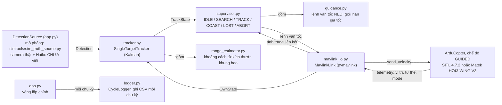

# DHTT-Drone-Tracking

Quad 8 inch tự bay, tự động bám một drone khác và giữ khoảng cách an toàn, dùng camera và ArduCopter.


> **Trạng thái (cập nhật 2026-11-17): giai đoạn mô phỏng, chặng 1. Chưa có lần bay thật nào.**
> - Bám bằng vị trí chuẩn của mục tiêu (`sim/`): đạt trong cửa sổ đo, còn lỗi phanh cuối chuyến.
> - Vòng kín bám bằng phát hiện tổng hợp (`onboard/simtools/`): **CHƯA ĐẠT** tiêu chí. Đã tìm ra nguyên nhân chính (drone bám dừng hẳn khi mất mục tiêu, giới hạn phanh quá thấp), đang sửa.
> - Camera và Hailo thật: **chưa viết**. Bộ cài trạm GCS: **chưa chạy** trên máy đích.
> - Lực cản và công suất là **tính tay**, chưa kiểm bằng mô phỏng.

## Dự án là gì

Drone quad 8 inch tự bay theo hành trình, hoặc bay bám một drone khác có tốc độ tương đương hoặc hơn, và giữ khoảng cách an toàn. Mẫu tham khảo là quad Blackbird trong video [The Fastest Drone Ever Flown](https://www.youtube.com/watch?v=k9n1h0rn9No).

- **Mô phỏng trước, phần cứng sau.** Mọi thuật toán chạy qua ArduPilot SITL trước khi lên drone.
- **Firmware ArduPilot (ArduCopter)**, không dùng PX4.
- **Radio** Radiomaster Pocket và RX XR4 chỉ dùng trong lab. Bay thật điều khiển qua trạm GCS (Mission Planner).

## Mục tiêu thiết kế

Đây là mục tiêu thiết kế. Chưa có phần cứng nào đạt các con số này.

| Hạng mục | Mục tiêu | Ghi chú |
|---|---|---|
| Tốc độ tối đa | 350 km/h | 400 km/h là phấn đấu |
| Tốc độ hành trình | 200–250 km/h | |
| Tốc độ mục tiêu drone bám được | khoảng 270–290 km/h | ước tính, chưa kiểm bằng mô phỏng |
| Khoảng cách giữ | 15 m (chặng 1) | nghiệm thu: sai số TB dưới 3 m, không bao giờ dưới 8 m |
| Góc nghiêng | 65–75° khi bay 350–400 km/h | ArduCopter giới hạn 80° |
| Điều khiển | Lệnh vận tốc NED, GUIDED, 10–20 Hz | qua pymavlink |

## Phần cứng dự kiến

| Hạng mục | Lựa chọn | Trạng thái |
|---|---|---|
| Flight controller | Matek H743-WING V3 (vào 9–36 V, cảm biến dòng khoảng 132 A) | dự kiến |
| Máy tính đồng hành | Raspberry Pi 5 8 GB kèm tản nhiệt | **đã có** |
| Tăng tốc AI | AI HAT+ (Hailo-8, 26 TOPS) | dự kiến |
| Camera | Raspberry Pi Global Shutter (IMX296, 1456×1088, ngàm CS), lens 6 mm hoặc 8 mm | dự kiến |
| Khung | Apex HD 8 inch 362 mm làm đế, vỏ in 3D kiểu tên lửa | dự kiến, số liệu khung chưa xác minh |
| Động lực | Motor 3110 **không đủ** (khoảng 0.9 kW mỗi cái). Ứng viên 3115, 3120, 3220 kèm ESC 200 A | chốt sau chặng 3 |
| Radio (lab) | Radiomaster Pocket + RX XR4 | **đã có** |
| Trạm GCS | Mission Planner trên laptop Windows 11, 10–13 inch cảm ứng, ngân sách 10–15 triệu đồng | chưa chọn máy |

## Kiến trúc phần mềm bám

Mã nằm trong `onboard/dtrack/`. Thiết kế ban đầu có 8 module. Hiện `capture` và `detect` gộp thành giao diện `DetectionSource` trong `app.py`, chưa có file riêng.



| Module | File | Vai trò |
|---|---|---|
| Hợp đồng dữ liệu | `onboard/dtrack/types.py` | `Detection`, `TrackState`, `OwnState`, `GuidanceCommand`; thế giới NED, thân FRD |
| Hình học | `onboard/dtrack/geometry.py` | Quaternion, chiếu tia camera sang NED |
| Bám | `onboard/dtrack/tracker.py` | Bộ lọc Kalman bám một mục tiêu |
| Khoảng cách | `onboard/dtrack/range_estimator.py` | Ước lượng khoảng cách từ kích thước khung bao (camera đơn không đo sâu trực tiếp) |
| Điều khiển | `onboard/dtrack/guidance.py` | Lệnh vận tốc, giới hạn gia tốc |
| Giám sát | `onboard/dtrack/supervisor.py` | Máy trạng thái, dừng, ABORT |
| MAVLink | `onboard/dtrack/mavlink_io.py` | Đọc telemetry, gửi lệnh vận tốc, RTL |
| Nhật ký | `onboard/dtrack/logger.py` | Ghi CSV mỗi chu kỳ |
| Vòng lặp | `onboard/dtrack/app.py` | Ghép các module; `config.py` nạp cấu hình |

## Cấu trúc thư mục

```
Drone-Tracking/
├── HANDOFF.md                 bản bàn giao: mục tiêu, quyết định, lệnh, lộ trình
├── .gitignore                 loại out/, *.BIN, __pycache__
├── onboard/                   phần mềm bám (Python)
│   ├── requirements.txt
│   ├── dtrack/                gói chính
│   ├── simtools/              vòng kín SITL: run_closed_loop.sh, sim_helper.py,
│   │                          sim_truth_source.py, analyze_closed_loop.py
│   └── tests/                 pytest
├── sim/                       chặng 1: chaser giữ 15 m (README.md)
│   └── setup_wsl.sh, run_sitl.sh, run_chase.sh, target.py, chaser.py, analyze.py
├── gcs/                       bộ cài trạm GCS, PowerShell 5.1 (README.md)
├── bom/                       Excel linh kiện: build_bom.py, bom_data.json, *.xlsx
└── .office/                   sổ ghi (ledger.md) và tiến trình (progress/)
```

Thư mục `out/` chứa kết quả chạy mô phỏng và được loại khỏi git.

## Trạng thái từng phần

| Phần | Trạng thái | Số đo (2026-11-17 trừ khi ghi khác) | Nguồn |
|---|---|---|---|
| `onboard/` pytest | ĐẠT (kiểm đơn vị) | 176 passed | sổ ghi 2026-11-17 (P3) |
| `onboard/` vòng kín SITL | CHƯA ĐẠT | lần chạy gần nhất của 6 kịch bản: 5 FAIL, 1 PASS (giành quyền) | bảng chi tiết bên dưới |
| `sim/` chặng 1, trong cửa sổ đo 120 s | ĐẠT trong cửa sổ | 10 m/s: sai số TB 0.32 m (phiên chính chạy lại); 20 m/s: 0.56 m | sổ ghi 2026-11-16 |
| `sim/` phanh cuối chuyến | CHƯA ĐẠT (lỗi đã biết) | khoảng cách thật tụt còn 0.14–6.61 m sau cửa sổ đo (3 lần chạy) | sổ ghi 2026-11-16, đọc log BIN |
| `gcs/` logic | ĐẠT (kiểm logic) | PASS=171, FAIL=0 | chạy lại 2026-11-17 |
| `gcs/` cài thật | CHƯA CHẠY THẬT | chưa có laptop đích; chữ ký gói chưa kiểm | `gcs/README.md` mục 6 |
| `bom/` | ĐÃ DỰNG, GIÁ CHƯA ĐỦ | 6 sheet; 1 máy có giá Taobao (CNY); nhiều dòng thiếu giá | sổ ghi 2026-11-16, 2026-11-17 |
| Phần cứng bay | CHƯA CHẠY THẬT | chưa bay lần nào | — |

<details>
<summary>Chi tiết các lần chạy vòng kín SITL gần nhất</summary>

Kịch bản: mục tiêu bay ở tốc độ đặt và đổi hướng định kỳ; drone bám giữ 15 m. Tiêu chí: sai số trung bình dưới 3 m trong cửa sổ 120 s, không bao giờ dưới 8 m, bám (TRACK) ít nhất 90% thời gian.

| Kịch bản | Lần chạy (2026-11-16) | Kết quả | Chi tiết |
|---|---|---|---|
| 10 m/s, seed 2 | 21:40 | FAIL | sai số TB 0.94 m (đạt); min 7.15 m xảy ra sau cửa sổ đo |
| 10 m/s, seed 3 | 21:44 | FAIL | sai số TB 14.95 m; TRACK 82.4% |
| 10 m/s, seed 1 | 21:32 | FAIL | sai số TB 1.34 m, min 10.31 m, TRACK 100%; chỉ hỏng ở khoảng trống dữ liệu 0.223 s trước cửa sổ đo |
| 20 m/s, seed 1 | 21:49 | FAIL | TRACK 1.9%, min 4.38 m (sai số TB không đáng tin khi TRACK thấp) |
| 10 m/s, mất hình 3 s | 21:55 | FAIL | min 5.21 m; sai số TB 8.18 m; TRACK 94.8% |
| 10 m/s, phi công giành quyền | 21:59 | PASS | ngừng gửi lệnh sau 0.021 s |

Giờ ghi là UTC. Nguyên nhân theo điều tra ngày 2026-11-17 (chưa có phép thử vòng kín xác nhận): khi mất mục tiêu drone bám dừng hẳn thay vì bay tiếp theo vận tốc ước lượng; giới hạn phanh 0.8 m/s² quá thấp nên lao quá gần khi mục tiêu giảm tốc; vòng giữ mục tiêu giữa ảnh bằng độ cao đẩy mục tiêu ra mép dưới khung hình; gia tốc ngang không đủ khi mục tiêu rẽ ở 20 m/s.

</details>

## Bắt đầu nhanh

**Yêu cầu:** Windows 11 với WSL2, distro `Ubuntu-24.04`, user có sudo. ArduPilot tag `Copter-4.7.2` đã build SITL (dựng bằng `sim/setup_wsl.sh`). Venv `~/venv-ardupilot` với pymavlink, MAVProxy, numpy, pytest, openpyxl; `bash -lc` tự nạp venv.

Thay `<repo-wsl>` bằng đường dẫn WSL tới thư mục repo (dạng `/mnt/<ổ đĩa>/...`). Lệnh chạy từ PowerShell, chuỗi bash đặt trong dấu nháy đơn.

```powershell
# Kiểm không còn SITL nào chạy trước mỗi lần thử (mã thoát 1 = không có)
wsl -d Ubuntu-24.04 -- pgrep arducopter

# Test phần mềm bám (kỳ vọng: 176 passed)
wsl -d Ubuntu-24.04 -- bash -lc 'cd <repo-wsl>/onboard; python -m pytest -q'

# Mô phỏng chặng 1, tốc độ đặt 10 hoặc 20 m/s (mất khoảng 3–4 phút mỗi lần; mã thoát 0 = PASS)
wsl -d Ubuntu-24.04 -- bash <repo-wsl>/sim/run_chase.sh 10

# Vòng kín với phát hiện tổng hợp (SCENARIO: none, blackout, disengage; SEED: seed)
wsl -d Ubuntu-24.04 -- bash -lc 'SEED=2 SCENARIO=none bash <repo-wsl>/onboard/simtools/run_closed_loop.sh 10'

# Dựng lại Excel linh kiện
wsl -d Ubuntu-24.04 -- bash -lc 'cd <repo-wsl>/bom; python build_bom.py'

# Test logic bộ cài GCS (chạy từ thư mục repo trên Windows, không cần admin)
powershell -ExecutionPolicy Bypass -File gcs\tests\Test-GcsLogic.ps1
```

Không chạy `gcs\Install-Gcs.ps1` trên máy cá nhân. Bộ cài chỉ dành cho laptop GCS riêng, cần quyền admin. Đọc `gcs/README.md` trước.

## Lộ trình

- [x] Hợp đồng dữ liệu và khối nhận biết đã viết; toàn bộ `onboard/` có 176 test qua (còn lỗi đã biết, xem T9d).
- [x] Dựng SITL ArduCopter 4.7.2 trong WSL2, mô hình freestyle cho tốc độ 20 m/s.
- [ ] **Chặng 1 hoàn tất**
  - [x] Bám bằng vị trí chuẩn trong cửa sổ đo (`sim/`), 10 và 20 m/s.
  - [ ] Sửa lỗi phanh cuối chuyến trong `sim/`, chấm toàn chuyến bay.
  - [ ] Vòng kín đạt tiêu chí ở 10 và 20 m/s.
  - [ ] Sửa lỗi khoảng cách trong bộ nhận biết (T9d).
  - [ ] Quyết định hướng camera: lens rộng hơn, gimbal một trục, hoặc giới hạn gia tốc của drone bám.
- [ ] **Chặng 2:** camera mô phỏng (Gazebo), YOLO, ước lượng khoảng cách từ ảnh.
- [ ] **Chặng 3:** mô hình lực cản thân tên lửa, nâng dần lên 250–350 km/h, chốt motor, ESC, pin, prop.
- [ ] **Phần cứng:** camera Global Shutter và Hailo trên Pi 5, bay thử trong lab, bộ GCS chạy thật trên laptop đích.

## Cách làm việc

- Mỗi bước xong là một commit. Sổ ghi `.office/ledger.md` chỉ ghi thêm, không sửa dòng cũ.
- Mỗi kết quả có ngày, mã task và bằng chứng. Số liệu trong README lấy từ sổ ghi hoặc file kết quả. Việc chưa kiểm được ghi rõ "chưa kiểm chứng".

## Lưu ý an toàn

- Đây là drone tốc độ cao. Mã phần mềm bám chưa kiểm trên phần cứng thật. Mọi tham số là đề xuất cho đến khi có bằng chứng bay thử.
- Không bay khi chưa đi hết `gcs/config/checklist-truoc-bay.md`.
- Tham số failsafe `gcs/config/dtrack-failsafe.param` là đề xuất, chưa bay thử. Duyệt từng giá trị trước khi nạp, đặt ngưỡng pin theo pack thật.
- Liên kết MAVLink hiện chưa bật xác thực (signing). Cần quyết định trước buổi bay thật. Chỉ bay bằng tài khoản Windows thường.
